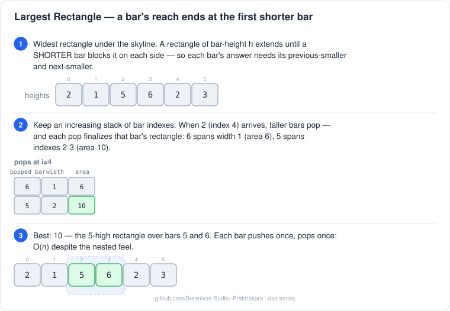

# Largest Rectangle in a Histogram

> Striver SDE Sheet 085 · Day 14 Stack & Queue II — a bar's rectangle is settled the moment a shorter bar arrives; a monotonic stack hands over both boundaries. Go, stdlib only, tested.

## Problem

Bars of given heights, width 1 each, stand side by side. Find the largest rectangle that fits entirely under them — the hardest of the classic stack problems and a frequent hard-tier interview finale.

## Approach

For each bar, the best rectangle *using its full height* extends to the nearest shorter bar on each side. Rather than computing those boundaries in separate passes, keep a stack of indexes with increasing heights: when a new bar is shorter than the top, the top's right boundary just arrived (the new bar), and its left boundary is already sitting beneath it on the stack — pop, compute `height × (right − left − 1)`, repeat. A zero-height sentinel bar appended at the end flushes every survivor. Each bar pushes and pops exactly once: linear, one pass, no prefix arrays.

**Complexity:** O(n) time, O(n) stack.

## Visual walkthrough

Read the picture top to bottom — each numbered frame is one moment of the algorithm
running on this repo's test example.

## Run

    go test ./...   # verify
    go run .        # demo

---

One of 191 repos solving Striver's SDE Sheet in Go — stdlib only, one problem per repo, every solution tested. Browse the set: [`dsa-*` repos](https://github.com/Sreenivas-Sadhu-Prabhakara?tab=repositories&q=dsa-&type=source).
